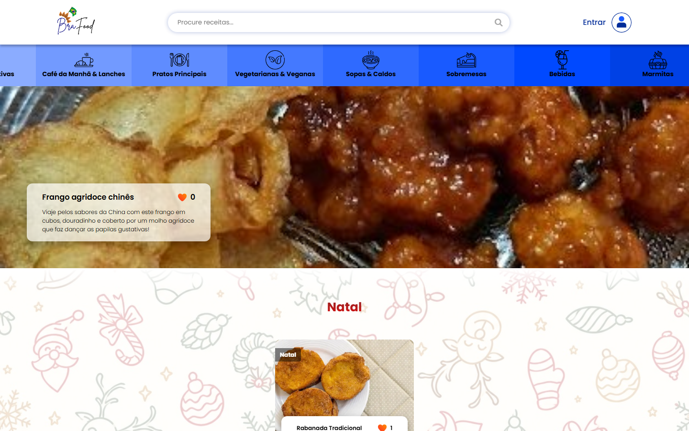
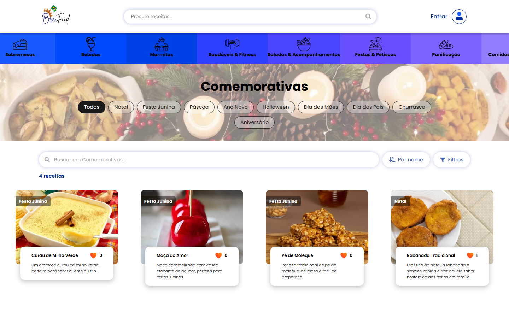
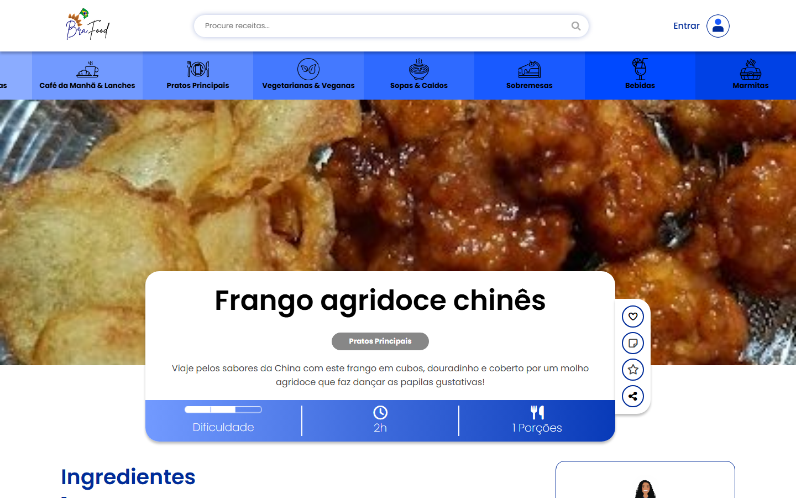
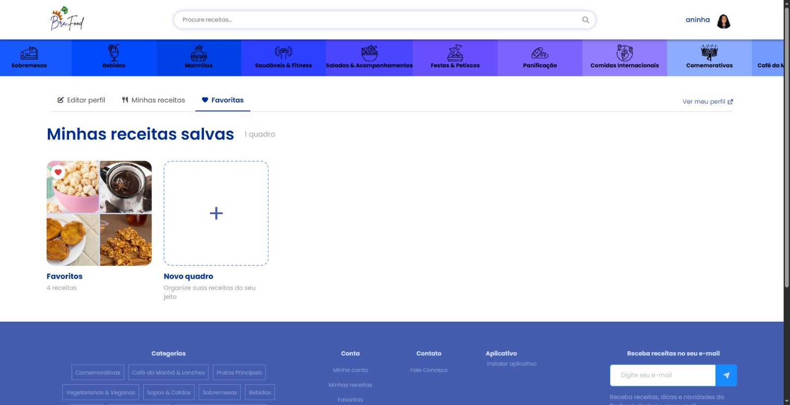
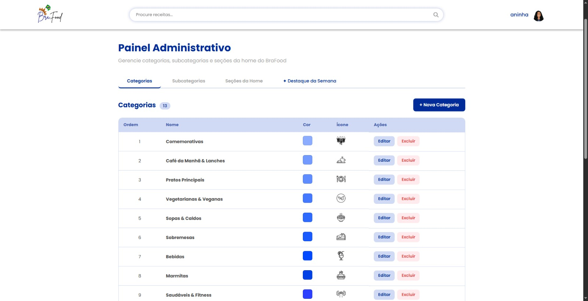

# BraFood — Front-end (Brafood-Angular)

Aplicação web de receitas em Angular. Permite buscar e filtrar receitas, publicar as próprias (inclusive a partir de texto, com IA), avaliar, comentar, salvar em quadros e administrar o conteúdo da home. Consome a API REST do repositório [Brafood-PHP](https://github.com/AnaSouzaPinheiro/Brafood-PHP).

- **Back-end:** [Brafood-PHP](https://github.com/AnaSouzaPinheiro/Brafood-PHP)
- **Licença:** MIT

## Telas








## Tecnologias

| Item | Detalhe (fonte: `package.json`) |
| --- | --- |
| Framework | Angular 20 (`^20.0.0`; instalado: 20.0.0), componentes standalone |
| Linguagem | TypeScript ~5.8 |
| Reatividade | RxJS ~7.8 e `signal` do Angular |
| Renderização | `@angular/ssr` com Express 5, hidratação com event replay e prerender das páginas fixas |
| UI | SCSS por componente, `@angular/cdk`, Font Awesome reduzido a um subset (`generate-fa-subset.js`); não há biblioteca de componentes como Angular Material |
| Qualidade | ESLint (`angular-eslint`), Jasmine e Karma |
| PWA | `manifest.webmanifest` e opção "Instalar aplicativo" |

## Funcionalidades

**Catálogo e descoberta**
- Home com slide, seções de carrossel e receita em destaque da semana, todos controlados pela API.
- Barra de categorias e página por categoria, com filtros (subcategoria, dificuldade, tipo de porção, tempo) e ordenação (por nome, mais novas, mais antigas, mais favoritas).
- Busca por texto (`/pesquisa/:nome`).

**Receita**
- Página com galeria de imagens, vídeo incorporado, ingredientes, modo de preparo, nota média, favoritar, comentários e compartilhamento dos ingredientes pelo WhatsApp.
- Avaliação com estrelas e comentários com respostas aninhadas (exigem login).

**Conta**
- Cadastro (com verificação e sugestão de apelido), login, logout, recuperação e redefinição de senha por e-mail.
- Edição de perfil e perfil público do chef por apelido (`/chef/:apelido`).

**Publicação**
- Cadastro e edição de receitas com capa, galeria, grupos de ingredientes e etapas; aviso ao sair com alterações não salvas.
- Geração de receita a partir de texto livre (IA), com escolha entre o fluxo manual e o fluxo com IA.
- Listagem das próprias receitas.

**Favoritos e quadros**
- Favoritas com status ("quero fazer", "já fiz") e nota pessoal, seleção e remoção em massa.
- Quadros de receitas salvas: criar, editar, organizar a ordem, tornar público e compartilhar por link; lista de compras gerada a partir do quadro.

**Administração (perfil administrador)**
- Painel em abas: categorias, subcategorias, seções da home (incluindo vínculo de receitas e imagens, com geração de imagens por IA) e receita em destaque.

**Outros**
- Newsletter, formulário de contato, páginas de termos, privacidade e cookies, banner de consentimento de cookies.
- `sitemap.xml` dinâmico gerado no servidor SSR (`src/sitemap.ts`).

## Rotas

Todas as rotas carregam seus componentes sob demanda (lazy).

| Rota | Componente | Guard |
| --- | --- | --- |
| `/` | redireciona para `/home` | — |
| `/home` | `Home` | — |
| `/login`, `/cadastro` | `Login`, `Cadastro` | — |
| `/recuperar-senha` | `RecuperarSenha` | — |
| `/resetar-senha/:token` | `ResetarSenha` | — |
| `/receita/:nome/:id` | `Recipe` | — |
| `/categoria/:nome/:id` | `Categoria` | — |
| `/pesquisa/:nome` | `Search` | — |
| `/chef/:apelido` | `PerfilPublicoPage` | — |
| `/quadro/:token` | `QuadroPublicoPage` | — |
| `/perfil/editar` | `EditarPerfil` | `AuthGuard` |
| `/perfil/receitas` | `MinhasReceitas` | `AuthGuard` |
| `/perfil/favoritas` | `Favoritas` | `AuthGuard` |
| `/perfil/favoritas/:id` | `Quadro` | `AuthGuard` |
| `/adicionar-receita` | `AddRecipe` | `AuthGuard`, `alteracoesGuard` (saída) |
| `/adicionar-receita/hub` | `AddRecipeHub` | `AuthGuard` |
| `/adicionar-receita/ai` | `AddRecipeAi` | `AuthGuard` |
| `/editar-receita/:nome/:id` | `UpdateRecipe` | `AuthGuard`, `alteracoesGuard` (saída) |
| `/admin` | redireciona para `/admin/categorias` | — |
| `/admin/:aba` | `PainelAdmin` | `AuthGuard`, `AdminGuard` |
| `/termos`, `/privacidade`, `/cookies`, `/contato` | páginas institucionais | — |
| `/editar-perfil/:id`, `/minhas-receitas/:id`, `/favoritas/:id` | redirecionam para as rotas `/perfil/...` | — |
| `**` | redireciona para `/home` | — |

Modo de renderização (`app.routes.server.ts`): `/`, `/home`, `/login`, `/cadastro`, `/recuperar-senha`, `/termos`, `/privacidade` e `/cookies` são prerenderizadas; `/receita/:nome/:id` usa renderização no servidor; as demais rotas são renderizadas no cliente.

## Arquitetura

```text
BraFood-Angular/
├── .github/workflows/deploy.yml   # Build de produção e deploy por FTP
├── public/                        # manifest, robots.txt e .htaccess (fallback das rotas)
├── src/
│   ├── app/
│   │   ├── admin/                 # Painel administrativo (abas)
│   │   ├── auth/                  # Login, cadastro, recuperação e redefinição de senha
│   │   ├── category/              # Página de categoria e filtros
│   │   ├── core/                  # Navbar, rodapé, busca, barra de categorias, banner de cookies
│   │   ├── home/                  # Slide, banner, destaque e seções
│   │   ├── interceptors/          # auth.interceptor.ts
│   │   ├── model/                 # Interfaces dos dados da API
│   │   ├── pages/                 # Contato e páginas legais
│   │   ├── profile/               # Perfil, favoritas, quadros, minhas receitas, lista de compras
│   │   ├── recipe/                # Página de receita, cards, cadastro, edição e IA
│   │   ├── services/              # Um serviço por domínio da API, mais serviços de estado
│   │   └── shared/                # Componentes, pipes e skeletons reutilizáveis
│   ├── environments/              # environment.ts (produção) e environment.development.ts
│   ├── server.ts                  # Servidor Express (SSR e sitemap)
│   └── sitemap.ts
├── angular.json
```

- **Serviços:** `BaseService` monta a URL da API; cada domínio estende essa classe (`ReceitaService`, `AuthService`, `FavoritoService`, `QuadroService`, `ComentarioService`, `AvaliacaoService`, `CategoriaService`, `AdminCategoriaService`, `AdminSecaoService`, `AiService`, entre outros).
- **Autenticação no front:** `AuthService` guarda o usuário em um `signal` e o token e o usuário no `localStorage`, reidratados na criação do serviço (somente no navegador, por causa do SSR).
- **Interceptor:** `authInterceptor` (registrado em `app.config.ts`) clona toda requisição e adiciona `Authorization: Bearer <token>` quando há token.
- **Guards:** `AuthGuard` exige login e redireciona para `/login`; `AdminGuard` exige `is_admin === 1` e redireciona para `/home`; `alteracoesGuard` pergunta antes de sair de um formulário com alterações não salvas. O `AdminGuard` só controla a navegação: a autorização real é feita pela API.
- **Estado:** não há biblioteca de estado (NgRx etc.). O estado compartilhado fica em serviços com `signal` (`AuthService`, `ModalService`, `ToastService`, `PwaInstallService`) e em `FilterStateService`, que guarda os filtros do catálogo.

## Integração com a API

A URL base fica em `src/environments/`:

| Arquivo | Uso | Chave |
| --- | --- | --- |
| `environment.development.ts` | desenvolvimento (substitui o arquivo padrão por `fileReplacements` na configuração `development`) | `apiUrl` apontando para a API local |
| `environment.ts` | produção | `apiUrl` apontando para `/api` no domínio de produção |

`BaseService` usa `${environment.apiUrl}/routes/<arquivo>.php`. Para trocar de backend, altere apenas `apiUrl` no arquivo do ambiente correspondente. A lista de endpoints está no README do [Brafood-PHP](https://github.com/AnaSouzaPinheiro/Brafood-PHP#endpoints).

## Como rodar

Pré-requisitos:
- Node.js compatível com o Angular 20 (20.19 ou superior, ou 22.12 ou superior; o workflow de deploy usa a versão 22) e npm.
- A API do [Brafood-PHP](https://github.com/AnaSouzaPinheiro/Brafood-PHP) rodando localmente. Siga o README dela e confira se a URL em `src/environments/environment.development.ts` aponta para o seu servidor.

```bash
git clone https://github.com/AnaSouzaPinheiro/Brafood-Angular.git
cd Brafood-Angular
npm ci
npm start            # ng serve, em http://localhost:4200
```

O Angular CLI é uma dependência de desenvolvimento do projeto (`@angular/cli` ^20), então não precisa ser instalado globalmente.

| Comando | Descrição |
| --- | --- |
| `npm start` | Servidor de desenvolvimento |
| `npm run build` | Build de produção (configuração padrão), saída em `dist/BraFood-Angular/` |
| `npm run watch` | Build contínuo em modo de desenvolvimento |
| `npm test` | Testes unitários (Karma/Jasmine). O projeto tem 80 arquivos `.spec.ts`.
| `npm run lint` | ESLint |
| `npm run serve:ssr:BraFood-Angular` | Executa o servidor SSR gerado pelo build |
| `npm run icons:subset` | Regera o subset do Font Awesome |

## Deploy

O workflow `.github/workflows/deploy.yml` roda a cada push na branch `main` (ou manualmente):

1. Confere os Secrets de FTP.
2. Instala o Node 22 e roda `npm ci`.
3. Executa `npm run build -- --configuration production`.
4. Verifica se `index.csr.html` e `.htaccess` existem na saída.
5. Envia `dist/BraFood-Angular/browser/` por FTP para o servidor.

## Minha parte

Projeto pessoal, projetado e desenvolvido integralmente por mim, Ana Letícia de Souza Pinheiro: modelagem, API, interface e deploy.

## Licença

Distribuído sob a licença MIT. Veja o arquivo [LICENSE](https://github.com/AnaSouzaPinheiro/Brafood-Angular/blob/main/LICENSE).

Copyright (c) 2026 Ana Letícia de Souza Pinheiro
